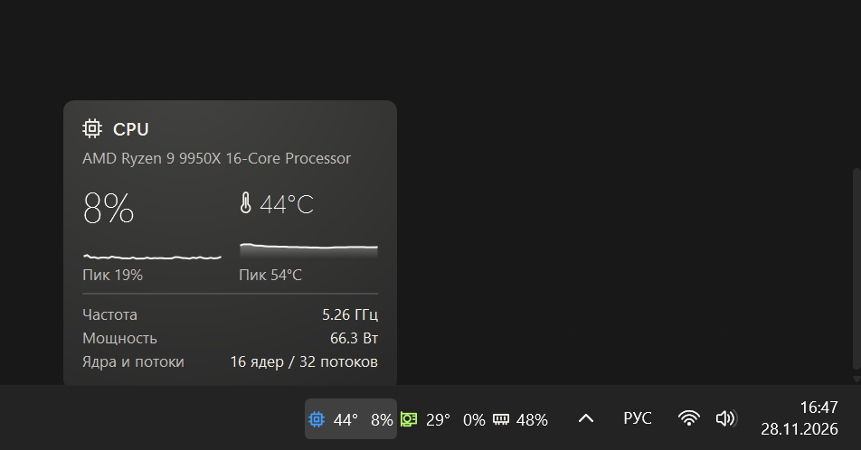
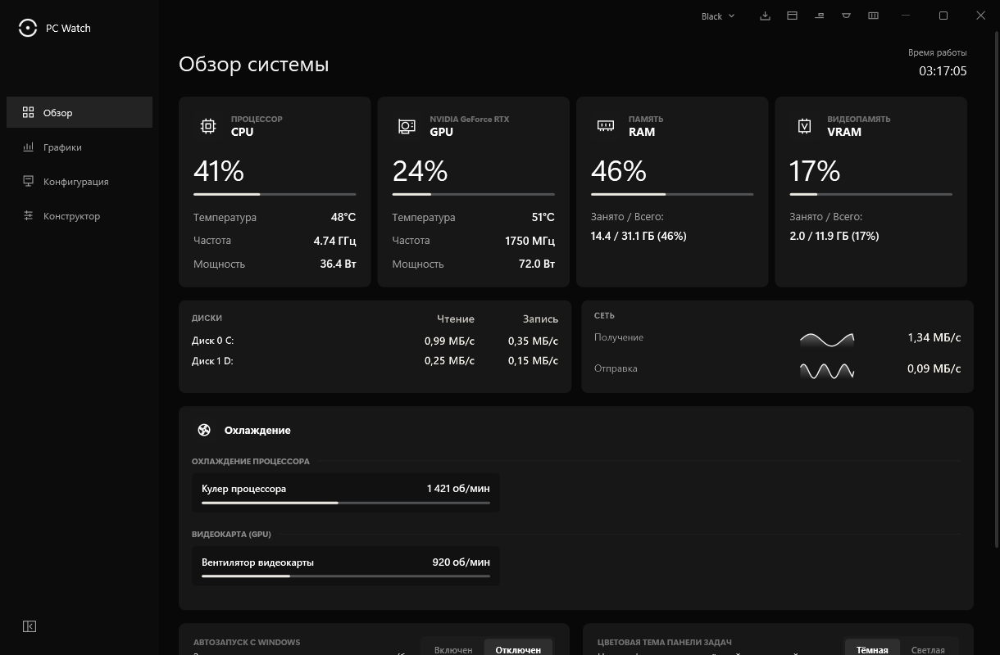
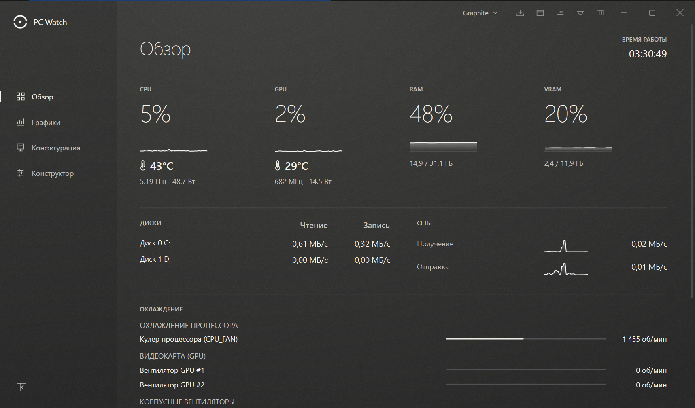
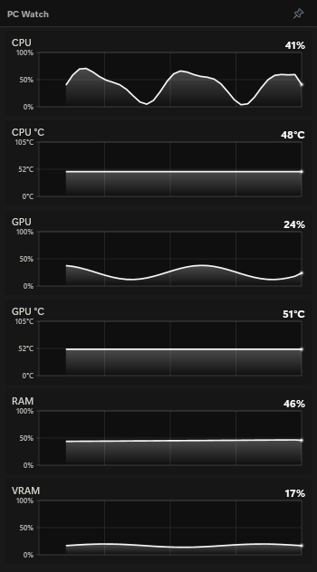

<div align="center">


# PC Watch

**Температура и загрузка ПК рядом с часами Windows**

Наведи на показатель, чтобы увидеть график и подробности. В полном обзоре можно сравнить нагрузку на процессор, видеокарту и память.

**[Скачать PCWatch.exe](https://github.com/vagabonb/PCWatch/releases/latest/download/PCWatch.exe)** · [Что нового](https://github.com/vagabonb/PCWatch/releases/latest)

Windows 10 и 11 x64 · Портативный EXE · Без установки



</div>

## Быстрый старт

1. Скачай и запусти **PCWatch.exe**.
2. В верхней строке приложения нажми значок **«На панель задач»**. Возле часов появятся показатели CPU, GPU и оперативной памяти.
3. Наведи на показатель для подробностей. Щёлкни по виджету, чтобы вернуться в полное окно.


В **«Конструкторе»** можно выбрать показатели, изменить их порядок и сразу увидеть результат в предпросмотре.

## Обзор и графики

В обзоре видны нагрузка, температура и частота CPU и GPU, расход RAM и VRAM, активность дисков и сети. На ноутбуке можно проверить заряд батареи, мощность разряда и примерное оставшееся время. Доступность показаний зависит от оборудования и драйверов.

Мощность отображается рядом со временем работы ПК. При зарядке ноутбук показывает, сколько ватт получает от адаптера. Знак ≥ означает, что доступна только часть измерений. Наведи на значение, чтобы узнать его источник. Чтобы видеть ватты рядом с часами Windows, включи «Потребление» в конструкторе панели задач.


<details>
<summary>Графики и конфигурация ПК</summary>

На вкладке «Графики» можно открыть отдельный показатель на всю ширину и настроить частоту опроса. Сведения о комплектующих копируются из «Конфигурации» одним нажатием.


</details>

<details>
<summary>Темы Black, Graphite и Color</summary>

**Black** — тёмные плоские карточки, **Graphite** — тонкая типографика с мини-графиками, **Color** — цветные кольца загрузки. Тема меняется в текущем окне.





[Графики в Graphite](docs/screenshots/charts-graphite.png) · [Ещё один снимок обзора Graphite](docs/screenshots/interface/overview-graphite-alternate.png)

</details>

## «Чёлка» и мини-окна

**«Чёлка»** живёт у верхнего края экрана. Можно выбрать кольцо, островок или шкалу. По нажатию открывается мини-обзор.


[Свёрнутый островок](docs/screenshots/interface/notch-closed.png) · [Батарея в мини-обзоре](docs/screenshots/notch-battery.png)

<details>
<summary>Микро, компактный режим и конструктор</summary>

**«Микро»** показывает несколько выбранных чисел. **«Компактный»** размещает графики друг под другом в отдельном узком окне. Оба режима настраиваются в «Конструкторе».




</details>

## Обновления

PC Watch предлагает скачать обновление при запуске. Если нажать «Позже», предложение появится при следующем запуске. При обновлении с Render Watch имя файла может остаться `RenderWatch.exe`. Настройки и история хранятся в `%LOCALAPPDATA%\RenderWatch`.

### Проверка скачанного файла

В релизах с версии 2.2 есть файл [SHA256SUMS.txt](https://github.com/vagabonb/PCWatch/releases/latest/download/SHA256SUMS.txt). Сравни сумму для `PCWatch.exe` с результатом команды, выполненной в папке со скачанным файлом.

```powershell
Get-FileHash -Algorithm SHA256 -LiteralPath .\PCWatch.exe
```

PC Watch распространяется без цифровой подписи, и при первом запуске Windows может показать предупреждение SmartScreen.

[Все релизы](https://github.com/vagabonb/PCWatch/releases) · [Сообщить о проблеме](https://github.com/vagabonb/PCWatch/issues/new)

## Сборка из исходников

PC Watch написан на C# и WPF. Для сборки нужен .NET 10 SDK на Windows.

```powershell
dotnet publish src/RenderWatch.App/RenderWatch.App.csproj -c Release -o publish
```

Готовый файл появится в `publish/PCWatch.exe`.

## Лицензия

Код PC Watch распространяется по [лицензии MIT](LICENSE). Условия распространения и исходники сторонних компонентов собраны в [THIRD-PARTY-NOTICES.txt](THIRD-PARTY-NOTICES.txt).
