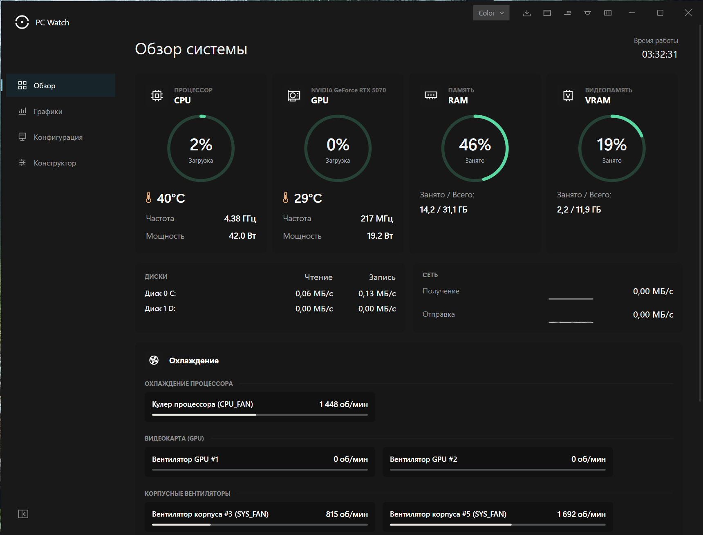
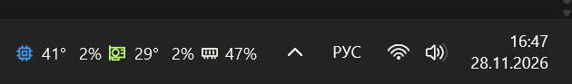
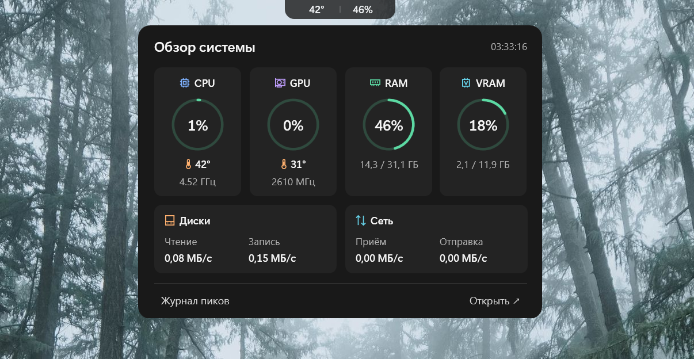
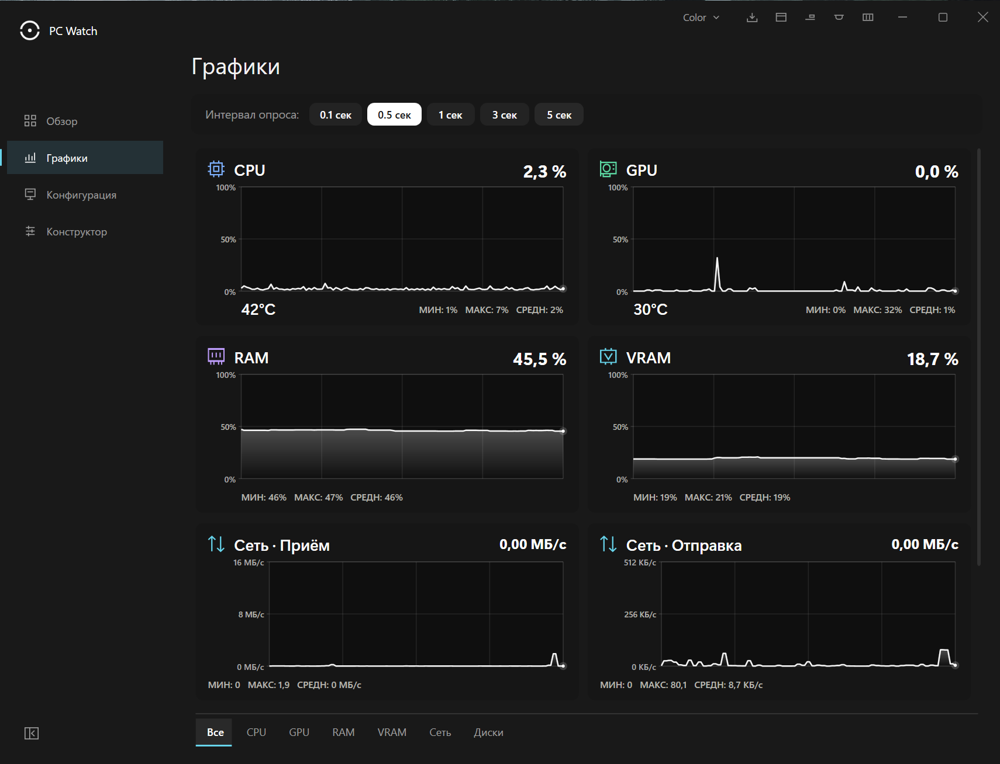
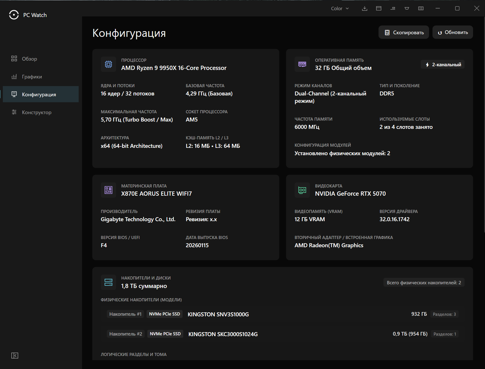
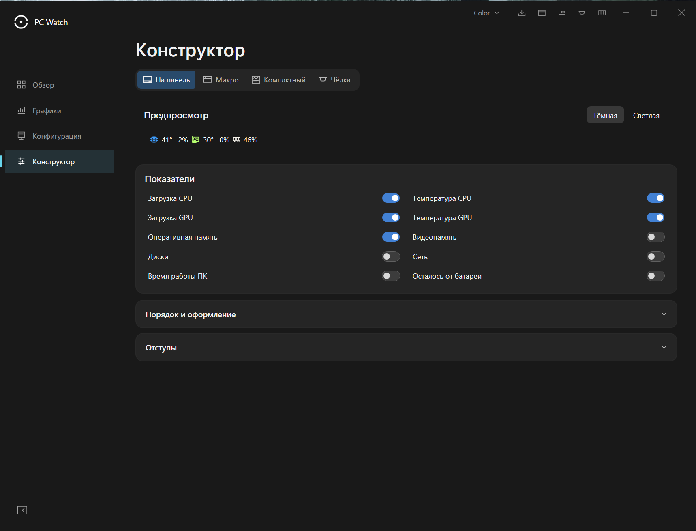

<div align="center">


# PC Watch

**Мониторинг ПК и ноутбука в реальном времени.**

Нагрузка, температура, память, диски и сеть в одном аккуратном окне.

[Скачать для Windows](https://github.com/vagabonb/PCWatch/releases/latest) · [Все релизы](https://github.com/vagabonb/PCWatch/releases)

</div>

<p align="center">
  
</p>

## Всё важное перед глазами

Открой полный обзор, чтобы изучить показатели, или оставь рядом с часами только нужные цифры.

- **Процессор и видеокарта** — загрузка, температура, частота и энергопотребление.
- **Память** — использование оперативной и видеопамяти.
- **Диски** — скорость чтения и записи отдельных физических накопителей.
- **Сеть** — приём и отправка с мини-графиками.
- **Охлаждение** — обороты доступных вентиляторов.
- **Батарея ноутбука** — заряд, мощность разряда и оценка оставшегося времени.
- **Время работы ПК** и сведения о конфигурации.

Доступность показаний зависит от оборудования и драйверов.

## Выбери свой вид

**Black** — тёмный интерфейс с плоскими карточками. **Graphite** — графитовый фон и тонкая типографика. **Color** — цветные индикаторы загрузки и кольцевые шкалы в обзоре. Темы переключаются на месте, а боковое меню можно свернуть до значков.

### Панель задач

В режиме **«На панель»** температура и загрузка видны рядом с часами. При наведении на показатель открывается карточка с подробностями и графиками. Для отдельного окна есть режимы **«Микро»** и **«Компактный»**.




### «Чёлка»

Виджет показывает выбранные показатели у верхнего края экрана. В конструкторе можно выбрать кольцо, островок или шкалу. По нажатию открывается мини-обзор системы.




### Остальные экраны

<details>
<summary>Графики нагрузки и активности</summary>

Графики показывают историю загрузки, температуры, активности сети и дисков. Можно открыть отдельный показатель и изменить интервал опроса.



</details>

<details>
<summary>Конфигурация компьютера</summary>

В конфигурации собраны сведения о компонентах компьютера. Их можно скопировать одним нажатием.



</details>

<details>
<summary>Конструктор виджетов</summary>

В конструкторе можно выбрать показатели, изменить порядок и оформление виджета и увидеть результат в предпросмотре.



</details>

<details>
<summary>Обзор и графики в теме Graphite</summary>


[Ещё один снимок обзора Graphite](docs/screenshots/interface/overview-graphite-alternate.png)


</details>

<details>
<summary>Батарея ноутбука в «Чёлке»</summary>


</details>

## Запуск

1. Скачай **PCWatch.exe** со [страницы релизов](https://github.com/vagabonb/PCWatch/releases/latest). В выпусках до 2.1.1 файл называется **RenderWatch.exe**.
2. Запусти файл на Windows 10 или 11 x64. Отдельно устанавливать .NET не нужно.
3. При желании настрой автозапуск и выбери показатели в конструкторе.

Обновление скачивается после подтверждения в уведомлении. Если нажать «Позже», предложение появится при следующем запуске. При переходе с Render Watch автообновление заменит файл по его прежнему пути. Название и значок внутри приложения обновятся, а настройки, история и автозапуск сохранятся.

Для ручного перехода закрой старую версию через трей и замени её файл. Если переименуешь файл в `PCWatch.exe`, обнови ярлыки и заново включи автозапуск из приложения, если он был включён. Настройки и история хранятся в `%LOCALAPPDATA%\RenderWatch`.

## Для разработки

Приложение написано на C# и WPF. Для сборки нужен .NET 10 SDK на Windows:

```powershell
dotnet publish src/RenderWatch.App/RenderWatch.App.csproj -c Release -o publish
```

Готовый файл появится в `publish/PCWatch.exe`.
