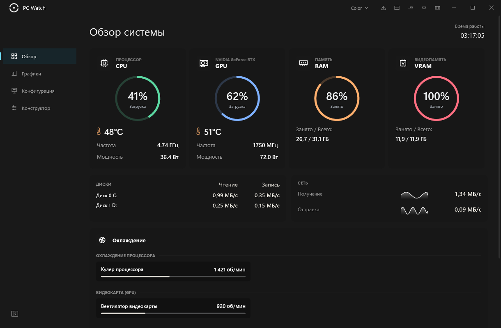
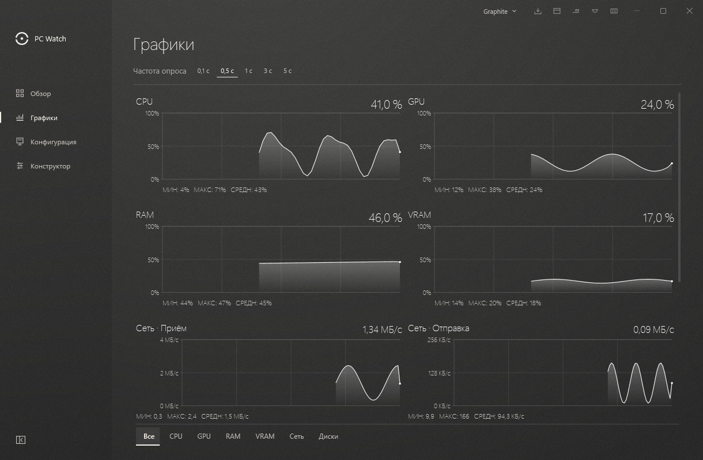
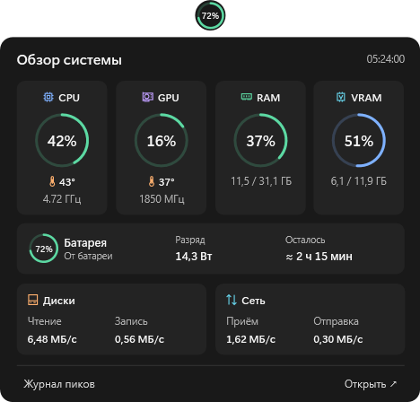

<div align="center">


# PC Watch

**Мониторинг ПК и ноутбука в реальном времени.**

Нагрузка, температура, память, диски и сеть в одном аккуратном окне.

[Скачать для Windows](https://github.com/vagabonb/PCWatch/releases/latest) · [Все релизы](https://github.com/vagabonb/PCWatch/releases)

</div>

<p align="center">
  
</p>

## Всё важное перед глазами

Открой полный обзор, чтобы изучить показатели, или оставь рядом с часами только нужные цифры.

- **Процессор и видеокарта** — загрузка, температура, частота и энергопотребление.
- **Память** — использование оперативной и видеопамяти.
- **Диски** — скорость чтения и записи отдельных физических накопителей.
- **Сеть** — приём и отправка с мини-графиками.
- **Охлаждение** — обороты доступных вентиляторов.
- **Батарея ноутбука** — заряд, мощность разряда и оценка оставшегося времени.
- **Время работы ПК** и сведения о конфигурации.

Доступность показаний зависит от оборудования и драйверов.

## Выбери свой вид

**Black** — тёмный интерфейс с плоскими карточками. **Graphite** — графитовый фон и тонкая типографика. **Color** — цветные индикаторы загрузки и кольцевые шкалы в обзоре. Темы переключаются на месте, а боковое меню можно свернуть до значков.

Когда большое окно не нужно, переключись в **компактный режим**, **микро** или режим **«На панель»**. Виджет на панели задач сам подстраивается под значки трея.

**Чёлка** показывает выбранные показатели у верхнего края экрана. В конструкторе можно выбрать кольцо, островок или шкалу. По нажатию чёлка раскрывает мини-обзор системы.

На вкладке **«Графики»** можно увидеть все показатели сразу или открыть отдельный график процессора, видеокарты, памяти, сети или дисков. Вкладка **«Конфигурация»** собирает сведения о компонентах компьютера.

<table>
  <tr>
    <th>Графики в Graphite</th>
    <th>Чёлка и батарея в Color</th>
  </tr>
  <tr>
    <td valign="top"></td>
    <td valign="top"></td>
  </tr>
</table>

## Запуск

1. Скачай **PCWatch.exe** со [страницы релизов](https://github.com/vagabonb/PCWatch/releases/latest). В выпусках до 2.1.1 файл называется **RenderWatch.exe**.
2. Запусти файл на Windows 10 или 11 x64. Отдельно устанавливать .NET не нужно.
3. При желании настрой автозапуск и выбери показатели в конструкторе.

Обновление скачивается после подтверждения в уведомлении. Если нажать «Позже», предложение появится при следующем запуске. При переходе с Render Watch автообновление заменит файл по его прежнему пути. Название и значок внутри приложения обновятся, а настройки, история и автозапуск сохранятся.

Для ручного перехода закрой старую версию через трей и замени её файл. Если переименуешь файл в `PCWatch.exe`, обнови ярлыки и заново включи автозапуск из приложения, если он был включён. Настройки и история хранятся в `%LOCALAPPDATA%\RenderWatch`.

## Для разработки

Приложение написано на C# и WPF. Для сборки нужен .NET 10 SDK на Windows:

```powershell
dotnet publish src/RenderWatch.App/RenderWatch.App.csproj -c Release -o publish
```

Готовый файл появится в `publish/PCWatch.exe`.
